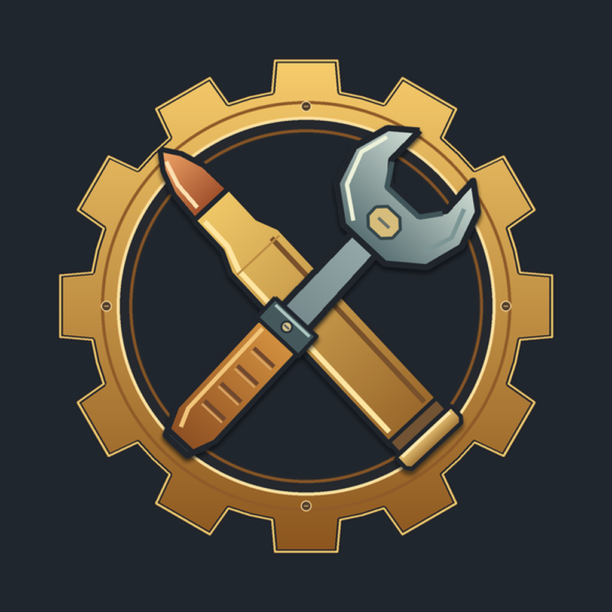

# AmmoCraft



**用机械动力，打造你的弹药生产线。**

AmmoCraft 是面向 Minecraft 1.18.2 Forge 的弹药制造模组，将机械动力（Create）的加工设备与永恒枪械工坊：零（Timeless and Classics Zero，TaCZ）的弹药连接起来。从刻制模板、搅拌弹壳到装药和压制，玩家可以搭建完整的自动化流水线，为枪械持续供应弹药。

## 核心玩法

- **19 种口径**：每种口径拥有对应的模板、弹壳、火药和半成品。
- **模板控制生产**：将模板放入工作盆过滤槽，选择要制造的弹壳；模板不消耗。
- **拆解与装药**：使用拆解钳获得对应口径火药，再通过机械手完成装药。
- **分阶段加工**：弹壳装药后成为半成品，可查看加工进度，最终压制为 TaCZ 弹药。
- **小批量制造**：弹壳与火药按口径分批生产，两者堆叠上限均为 60。
- **中英双语**：物品名称、模板说明和加工进度支持简体中文与英文。
- **JEI 兼容**：安装 JEI 后，弹壳配方会显示对应模板及过滤槽提示。

## 安装

当前版本：**1.0.0**。当前分支：**`1.18.2-forge`**。

| 组件 | 版本 |
| --- | --- |
| Minecraft | 1.18.2 |
| Forge | 40.2.21（开发与验证版本） |
| Create | 0.5.0.i |
| Flywheel | 0.6.8.a |
| TaCZ | 1.1.4 或更新版本，需对应 Minecraft 1.18.2 |
| Java | 17 |

将 AmmoCraft 与对应版本的依赖模组放入游戏实例的 `mods` 文件夹。多人游戏需要在客户端和服务端安装。

TaCZ 提供最终弹药物品，是使用完整制造流程所需的配套模组。JEI 为可选组件，推荐安装以查看配方。本项目不内嵌这些依赖。

## 制造流程

1. **制作空白模板**：用动力合成器将四个黑曜石按 2×2 排列，制作空白子弹模板。
2. **刻制口径模板**：机械手持对应的 TaCZ 弹药加工空白模板，得到口径模板；弹药样品保留。
3. **生产弹壳**：将模板放入工作盆过滤槽，使用动力搅拌器加工对应的铜、铁等原料。
4. **获取口径火药**：机械手持拆解钳拆卸一发对应弹药，获得口径火药；弹药消耗，拆解钳保留。
5. **批量生产火药**：将口径火药放入工作盆过滤槽，用普通火药及指定添加物进行搅拌。部分口径需要青金石粉或烈焰粉；青金石粉由动力压制器压制青金石获得。
6. **装药与压制**：机械手将对应火药装入弹壳，再由动力压制器完成弹药。12 号霰弹在装药后还需由机械手加入一枚铁粒。

具体原料数量与配方以游戏内显示为准。

## 支持口径

| 类别 | 口径 |
| --- | --- |
| 手枪及小口径弹药 | 9mm、.45 ACP、.357 Magnum、.50 AE、4.6×30mm、5.7×28mm、7.62×25mm |
| 步枪弹药 | 5.8×42mm、6.8×51mm FURY、5.56×45mm、7.62×39mm、7.62×54mm、.308 Winchester、.30-06 Springfield |
| 大口径弹药 | .338 Lapua Magnum、.50 BMG |
| 其他 | 12 号霰弹、40mm 榴弹、RPG 火箭弹 |

## 开发与构建

使用 Java 17 和项目自带的 Gradle Wrapper 构建：

```powershell
.\gradlew.bat build --console=plain
```

构建产物位于 `build/libs/AmmoCraft-1.0.0.jar`。首次构建需要下载依赖，缓存齐全后可添加 `--offline`。Linux / macOS 可使用 `./gradlew`。

运行游戏内回归测试：

```powershell
.\gradlew.bat runGameTestServer --console=plain
```

资源维护及核验工具需要 Python 3.9+ 和 Pillow：

```powershell
python -m pip install -r tools/requirements.txt
python tools/generate_recipes.py --check
python tools/verify_ammo_artifact.py --resources
python tools/verify_ammo_artifact.py
```

`generate_recipes.py` 可从物品注册参数生成配方；`generate_item_resources.py` 用于维护弹壳模型、翻译与传送带标签。生产资源位于 `src/main/resources/`。

## 许可证

项目代码采用 [MIT 许可证](LICENSE)。
